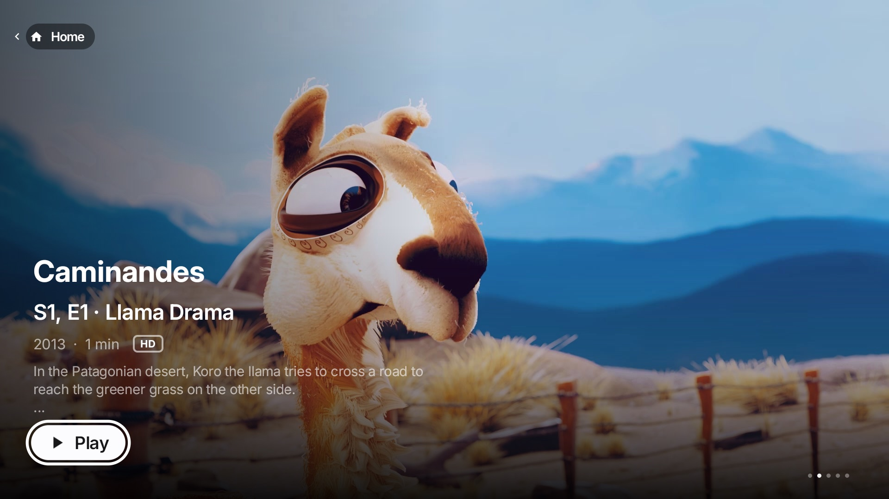
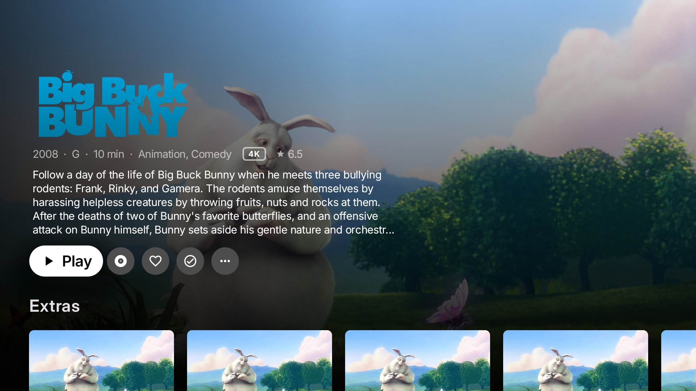
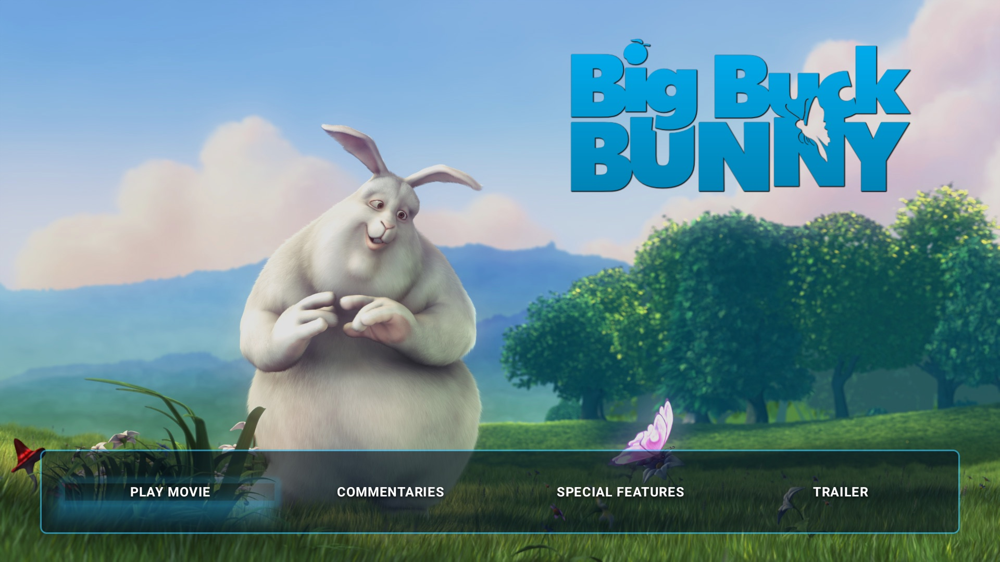
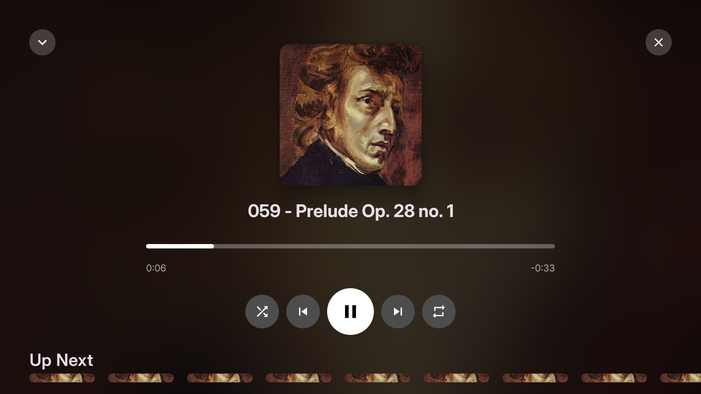
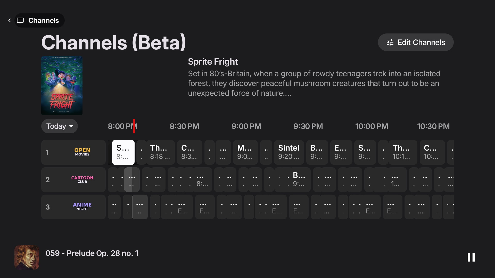
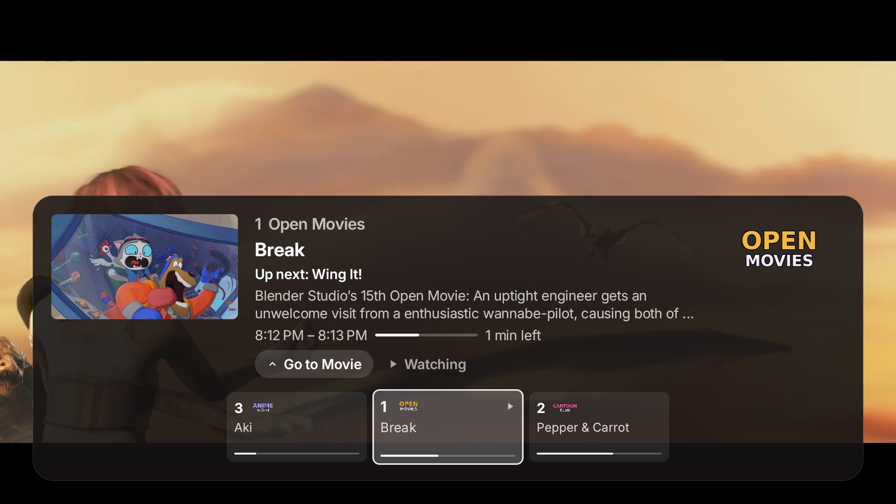
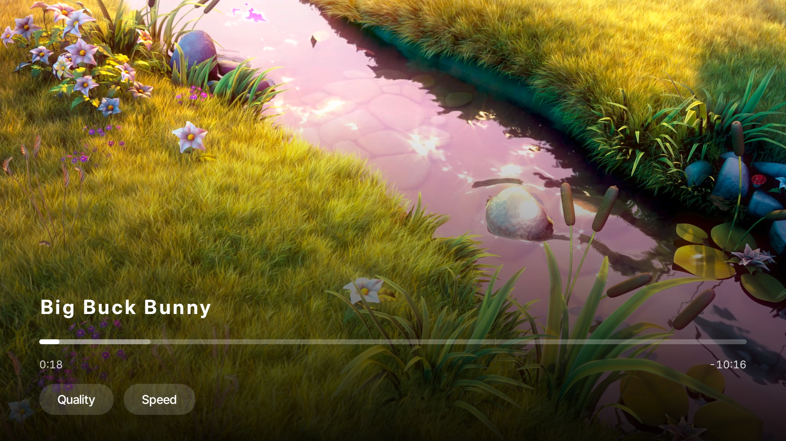
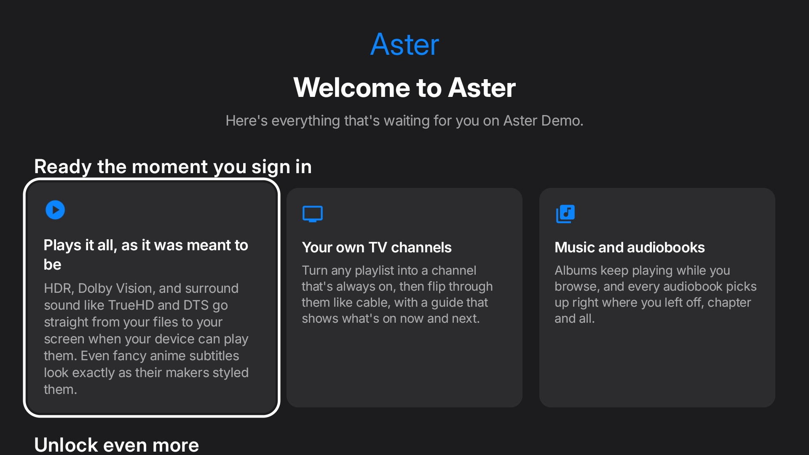

<p align="center">
  
</p>

# Aster Media Player for Android

A native Jellyfin, Emby and Plex client for Android TV, phones and tablets, written in Kotlin and Jetpack Compose.

Aster covers movies, TV, anime, music, audiobooks and live TV, and can turn your Jellyfin playlists into TV-style channels. Title pages are laid out like the Apple TV app, with theme music and theme videos, and it plays DVD/Blu-ray-style disc menus from the Aster Disc plugin. It is the Android counterpart of [Aster Media Player for Apple platforms](https://github.com/AsterMediaPlayer/Aster-Media-Player), and follows that app's design and behaviour.

> Aster for Android is in development. It is built and tested mainly on a TV box (an onn. 4K Pro); the phone layouts have had less testing. Expect rough edges, and please report what you find.

## Screenshots

Taken on an Android TV box (an onn. 4K Pro), against a demo server of open-licensed films.

| | |
| --- | --- |
|  |  |
| **Title page**: full-bleed art and logo, extras, and a button for the disc menu | **Disc menus**: Aster Disc menus drawn full screen, here Big Buck Bunny's |
|  |  |
| **Music**: Now Playing, with what's up next | **Channels**: playlists as TV channels in a guide, with music still playing below |
|  |  |
| **Channel row**: press Up while watching to flick through channels, or Go to Movie | **Player**: scrub bar, chapters, subtitles, quality and speed |
|  | |
| **Welcome**: shown once for each Jellyfin server, with the companion plugins | |

## Platforms

| | Android TV | Phone & tablet |
| --- | :---: | :---: |
| Browsing, title pages, search | ✓ | ✓ |
| Video playback (direct play, with a transcode fallback) | ✓ | ✓ |
| Music and audiobooks, with a now-playing bar | ✓ | ✓ |
| Live TV, guide, recordings | ✓ | ✓ |
| Channels from playlists (beta) | ✓ | ✓ |
| Disc menus | ✓ | ✓ |
| Downloads for offline viewing | | ✓ |
| Cast to a Chromecast | | ✓ |
| Built for a remote (focus, long-press, side menu) | ✓ | |

Requires Android 8.0 (API 26) or later.

## Servers

| | Jellyfin | Emby | Plex |
| --- | :---: | :---: | :---: |
| Sign in with a password, saved servers, switching | ✓ | ✓ | ✓ (link code from plex.tv/link) |
| Quick Connect | ✓ | | |
| Home, libraries, title pages, search, playback | ✓ | ✓ | ✓ (movies and TV) |
| Skip Intro | ✓ (media segments) | ✓ (intro chapter markers) | ✓ (Plex's markers) |
| Skip Credits | ✓ | | ✓ (Plex's markers) |
| Scrub thumbnails | ✓ (trickplay) | ✓ (preview thumbnails, once Emby has made them) | |
| Openings and endings from chapter markers | ✓ | ✓ | ✓ |
| Song card with the song and artist | ✓ (OP/ED plugin) | ✓ (AnimeThemes) | ✓ (AnimeThemes) |
| Live TV and recordings | ✓ | not tested | |
| Channels (beta), Disc Menus, Server Plugins | ✓ | | |
| OP/ED plugin themes (song, artist, full version, music video) | ✓ | | |

Aster is developed against Jellyfin 12 and Emby 4.11. Emby support goes through a translation layer that maps Emby's numeric ids and older routes onto the Jellyfin SDK, so some Jellyfin-only features are hidden on Emby. Plex goes through the same idea: a client that answers the SDK's calls from Plex's own API, so the screens are the same. Plex support is a first pass, covering movies and TV; music, photos and Live TV aren't there yet.

## Features

### Watching
- **Home**: Continue Watching, Up Next, recently added shelves, and one shelf per library.
- **Title pages**: full-bleed art with the show's logo, seasons and episodes, cast, extras and related titles. Theme music and muted looping theme videos fade in and out as you move between pages.
- **Anime**: openings and endings for each show as picture cards (a frame from the video, OP/ED badge, length, song, artist, season and episodes), with Play All, Shuffle and a Now Playing panel. They come from the Aster OP-ED plugin when it's on your server, or from the "OP" and "ED" chapters in your own episodes. Holding a card picks a version or adds that song to a playlist.
- **Upcoming**: episodes airing soon from the shows in your library.
- **Skip Intro, Skip Credits and Play Next Episode**, with optional automatic skipping.
- **Subtitles and audio**: styled ASS/SSA subtitles are drawn with libass; text tracks are drawn by the app; any audio or subtitle track can be switched during playback.
- **Plays what your device can**: Aster asks the device which video codecs it decodes in hardware (and up to what size and bit depth) and whether it can decode or pass through DTS, TrueHD and Dolby audio, and tells the server, so only what the device can't play is converted.
- **Quality**: Auto or a fixed quality, with an offer to step down when playback keeps stalling.
- **Chromecast** (phone): the Cast button in the player hands the title to a Chromecast from where it is, as H.264 (copied when it already is, converted when not) with the text subtitles as separate tracks, and the phone becomes the remote; ending the session picks up on the phone. Picture subtitles are burned in by the server.
- **Trickplay**: scrub thumbnails on the progress bar: Jellyfin's trickplay images, or on Emby its video preview thumbnails (turn on "video preview thumbnail extraction" in the library's settings, and Emby makes them when its scheduled task runs).
- **Song card**: while an opening or ending plays (or at the start and end of a music video), a card in the lower left names the song, its artists and the show. The OP/ED plugin gives the details; without it (Plex, Emby) they come from [AnimeThemes](https://animethemes.moe), found by the season's AniDB id or the show's name and year. Openings and endings are placed from the episode's chapters, best effort, or from the server's intro and credits markers. Settings ▸ Playback turns it off.
- **Add to Playlist**: from any movie, episode, show or season, to an existing video playlist or a new one.
- **Disc menus**: the Aster Disc plugin's menus, drawn full screen with their backgrounds, trailers, layers, themes, scene selection, paging, music and button sounds. Play, extras, chapters and whole shows play from the menu, and you come back to where you left it.

### Music and audiobooks
- Albums, artists, playlists and songs, with a now-playing bar and a full-screen player with shuffle, repeat, Up Next and lyrics.
- Audiobooks with a shelf per library and progress reported back to the server.

### Live TV and Channels
- A TV guide with programme details, recordings, and series recording rules.
- **Channels (beta)**: turn video playlists into channels that schedule themselves (rotation, blocks, shuffle, in order), with groups, the guide, and press Up while watching to flick through channels. Administrators edit channels from Settings or by selecting a channel in the guide.

### Accounts and servers
- Several servers and users stay signed in, with an optional password to switch to one and a lock after time away from the app.
- Settings follow the Apple apps' layout: Playback, Audio & Subtitles, Disc Menus, Title Pages, Channels, Server Plugins, Account and About.
- **Welcome screen**: shown once for each Jellyfin server you sign in to, with what Aster does and what its companion plugins add; an administrator can switch the plugins on from it. Settings ▸ Server Plugins brings it back.
- **Server Plugins** shows which of Aster's companion plugins are on your server, and for an administrator installs them, turns them on or off, and restarts the server.

## Companion plugins

These are optional Jellyfin plugins from the [Aster companion plugins](https://github.com/AsterMediaPlayer/aster-companion-plugins) repository. Add its manifest under Dashboard → Plugins → Repositories, or switch them on from Settings → Server Plugins as an administrator:

```
https://raw.githubusercontent.com/AsterMediaPlayer/aster-companion-plugins/main/manifest.json
```

- **Aster OP-ED**: every anime opening and ending, with song and artist.
- **Aster Disc**: real DVD/Blu-ray-style disc menus.
- **Aster Channels**: group your Live TV channels and manage Aster's channels from the dashboard.

## Building

You need Android Studio (or the Android SDK and JDK 17 or later) and a device or emulator.

```sh
git clone https://github.com/AsterMediaPlayer/aster-android.git
cd aster-android
./gradlew :app:assembleDebug     # app/build/outputs/apk/debug/app-debug.apk
./gradlew :app:testDebugUnitTest # unit tests
```

Install the debug build with `adb install -r app/build/outputs/apk/debug/app-debug.apk`. To run a second copy beside another install (for example to test against another server), build with `-PappIdSuffix=.test`.

A release build signs with a keystore described by a `keystore.properties` file, which is not in the repository. Without it, build the debug variant.

### How it's put together

- **`data/`**: `AsterRepository` is the app's one view of the server: browsing, playback, playlists, plugins, saved servers. `data/emby` translates Emby's routes and ids for the Jellyfin SDK; `data/disc` holds the disc menu model and its pure layout and focus rules, checked against the plugin's own conformance vectors in the unit tests.
- **`ui/`**: Jetpack Compose screens by area (`home`, `detail`, `player`, `music`, `audiobooks`, `livetv`, `guide`, `channels`, `disc`, `settings`, `auth`, `downloads`). One set of screens serves a TV and a phone, switching on `LocalIsTv`.
- **`ui/theme`**: the design system, including the TV focus treatment and sizes taken from the Apple TV app.

Built with [Jetpack Compose](https://developer.android.com/jetpack/compose), [Media3 / ExoPlayer](https://developer.android.com/media/media3) with [libass](https://github.com/peerless2012/libass-android) for styled subtitles, the [Jellyfin Kotlin SDK](https://github.com/jellyfin/jellyfin-sdk-kotlin), [Coil](https://coil-kt.github.io/coil/) and [OkHttp](https://square.github.io/okhttp/).

## Testing

The unit tests cover the disc menu rules (against the plugin's conformance vectors), Emby's id and response translation (against responses from a real Emby 4.11 server), intro and credits markers, openings and endings from chapters, the song card's timing and AnimeThemes lookup, Plex's response translation, and the subtitle, trickplay (including Emby's BIF files) and schedule logic.

## Built with, and licenses

| Component | License |
| --- | --- |
| [Media3 / ExoPlayer](https://github.com/androidx/media) | Apache-2.0 |
| [libass-android](https://github.com/peerless2012/libass-android) | MIT |
| ↳ [libass](https://github.com/libass/libass) | ISC |
| [Jellyfin Kotlin SDK](https://github.com/jellyfin/jellyfin-sdk-kotlin) | LGPL-3.0, used as an unmodified library |
| [Coil](https://github.com/coil-kt/coil), [OkHttp](https://square.github.io/okhttp/), Jetpack Compose | Apache-2.0 |
| Google Cast SDK | Google's [terms](https://developers.google.com/cast/docs/terms) |
| [Inter](https://rsms.me/inter/) (typeface, see `licenses/`) | SIL OFL 1.1 |

## License

Aster for Android is licensed under the [Mozilla Public License 2.0](LICENSE), the same as the Apple app. You're free to use, modify and redistribute it. If you distribute a modified version, the files of Aster you changed must stay available under the MPL. New files you add can use any license. The components above keep their own licenses.

The Aster name and app icon aren't covered by the license. If you publish your own build, for example on Google Play, give it a different name and icon so people don't confuse it with the official app.

Aster isn't affiliated with or endorsed by the Jellyfin project.

## Not yet in Android

Things the Apple apps have that Android doesn't yet:

- Plex: music, photos and Live TV, scrub thumbnails, and Plex-specific features beyond a first pass at movies and TV.
- On Emby: Skip Credits, and Live TV is untested.
